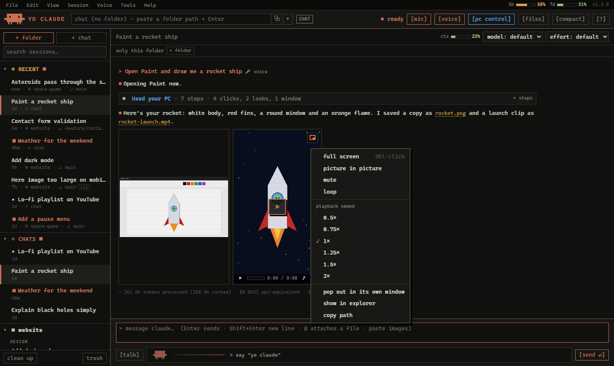
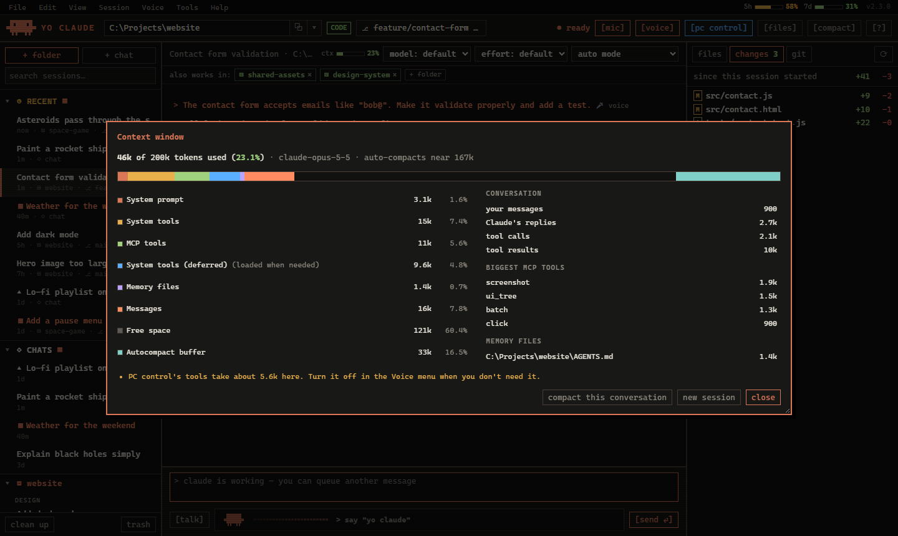

# Yo Claude

A "Hey Siri" for Claude on Windows. Say **"yo claude"**, ask anything out loud, and Claude answers in a natural
voice. Point it at a folder and it becomes a voice-first coding assistant: it reads and edits code, and shows its
work, every file it changed and your git branch. With PC control on, it can also use your screen, mouse and keyboard.

Unofficial fan project, not made or supported by Anthropic. Uses your own Claude account through Claude Code.


**Coding by voice or text.** Folders and their sessions on the left (spinning while Claude works, a dot for replies you
haven't read), Claude's steps folded into one-line summaries, and everything the session changed on the right. The
meters at the top show how full this conversation is and how much of your plan's limits you've used.


**PC control.** "Open Paint and draw me a rocket ship": every click is grouped into one summary you can expand, with
what Claude saw, and a live view of the screen while it works.

| Pictures and video in the chat | What's using the context window |
|---|---|
|  |  |
| **The compact bar** | **Cleaning up old conversations** |
|  |  |


*(Screenshots use made-up content.)*

## What you need

- Windows 10 or 11, a microphone and speakers.
- A Claude **Pro or Max** subscription (Yo Claude uses it through Claude Code; it doesn't need an API key).
- Git, to download and update it: `winget install -e --id Git.Git` if you don't have it.

## Install

Open **PowerShell** and run:

```powershell
git clone https://github.com/SheldonNeilson/Yo-Claude.git "$env:LOCALAPPDATA\YoClaude"
& "$env:LOCALAPPDATA\YoClaude\Install Yo Claude.cmd"
```

The first command may ask you to sign in to GitHub (the repo is private: you need an invite). The installer then:

1. installs Python 3.13 if you don't have a suitable version (it asks first),
2. installs Yo Claude's packages, and PC control's in a separate environment,
3. downloads the speech models (about 550 MB; speech is recognised on your PC),
4. installs **Claude Code** if needed (asks first; Anthropic's official installer) and signs you in,
5. starts Yo Claude. It adds itself to the Desktop and Start menu and starts with Windows.

The first time, a welcome tour explains everything and checks how well it hears you (about two minutes).

## Using it

### Talking

- **Say "yo claude"**, wait for "how can I help?", then speak. Pause briefly when you're done. You can also say it in
  one breath: "yo claude, what's the weather tomorrow?"
- **Follow-ups**: after it answers it listens for about 6 seconds, so you can carry on without the wake word.
  "Never mind" ends it.
- **Voice commands**: "new session", "new chat", "switch to *session name*".
- **Approvals**: when Claude asks permission, say "yes, go ahead" or "no", or click.
- **Stop** anything: `[■]`, Esc, a right-click on the bar, or the tray menu.
- **Mishearing you?** Turn on **Voice → More accurate speech recognition**. It uses a bigger speech model: slower,
  and a one-off download of about 1.5 GB.

### The window

- **Menus** along the top (File, Edit, View, Session, Voice, Tools, Help) have every setting, with keyboard shortcuts
  (Help → Keyboard shortcuts). Hover anything for a short explanation.
- **Type** instead of talking: `@` attaches a file, and you can paste screenshots.
- **Copy anything**: select it and press Ctrl+C, use a message's **⧉ copy** button, or right-click for Copy, Copy
  message, Copy code and Copy whole conversation.
- **Model and effort** are picked per session, at the top of the conversation.
- **Compact mode**: close or minimise the window and a small bar stays at the bottom of the screen. `[⤢]` opens the
  window again.
- **Tray icon** (bottom right): the wake word, voice replies, PC control, the floating bar, launch with Windows,
  training mode, updates, and Quit.

### Folders and sessions

- `+ folder` adds a folder to the tree on the left; hover it and click `+` for a new session there. Or paste or type a
  folder path into the box at the top and press Enter. Sessions in different folders can work at the same time.
- **Recent** at the top lists the latest sessions from every folder, and folders with recent activity open by
  themselves. Your Claude Code sessions for the same folders show up too (marked `cli`).
- **More than one folder**: a session can also read and write other folders. Use `+ folder` in the row under the
  session title; remove one with its `×`.
- Right-click a session to rename, pin, group, fork or delete it. **clean up** suggests old and empty conversations to
  move to the trash, and **trash** brings them back.

### Coding

- In a folder session, the right-hand panel shows the files, everything changed in the session (with diffs and
  per-file revert) and your git branch.
- The mode dropdown sets how much Claude asks first: **auto** (Claude Code's safety check decides; always the
  default), *ask before changes*, *auto-accept edits* or *plan*. A change applies to that session only.
- **Background tasks** Claude starts (long renders, builds) show in the conversation with a timer and a stop button,
  and as a purple spinner in the tree. They keep running if Yo Claude restarts, and Claude reports back when they
  finish.

### Files, pictures and video

- File and folder paths in Claude's replies are links: click to preview, right-click for open, **open with…** (the
  apps Windows has for that file type), show in Explorer and copy path.
- Pictures, videos, audio and PDFs a reply mentions appear under it. Click one to view it bigger, or **pop out** to
  get it in its own resizable window.
- Videos play in the chat. The button at the top right plays them **picture in picture**, on top of other windows,
  and **⋮** (or a right-click) has full screen, speed, loop and more.
- If something can't be opened (moved, deleted, or no app for that kind of file), it tells you why.

### Context and usage limits

- **ctx** next to the model picker shows how full this conversation's context window is. Click it to see what's
  using it (system prompt, tools, PC control, memory files, your messages, tool results), with tips to free some up,
  **compact this conversation**, or start a **new session**.
- **5h** and **7d** at the top right are your Claude plan's 5-hour and weekly limits, shared with Claude Code and the
  Claude app. Hover them for when they reset, or click for details. They update with each reply.
- The bars turn amber past 50% and red past 80%.

## PC control

It's **on** after install. When you ask ("open YouTube and play lo-fi music"), Claude can see your screen and use
your mouse and keyboard, as you, with your logins.

- **Ctrl+Alt+X** stops it instantly. Slamming the mouse into a screen corner also aborts.
- Switch it off with `[pc control]` at the top of the window, in the Voice menu, or in the tray menu.
- It asks before anything hard to undo (sending, deleting, buying), but don't leave it unattended on anything
  sensitive.
- Its tools take about 11k tokens of every conversation (screenshots add more; the **ctx** meter shows it), so turn
  it off when you don't need it.
- Everything it does is logged in `%USERPROFILE%\.yoclaude\pc-control\screen-control.log`.

## Privacy and cost

- Your **audio never leaves your PC**. The wake word and speech-to-text run locally; only the transcribed text goes
  to Claude.
- Replies are read aloud by Microsoft's online neural voice, so the reply text goes to Microsoft.
- Questions count against your Claude plan like Claude Code messages. A chat question is about 4k tokens; a coding
  session carries more (the full Claude Code toolset), mostly cached. Each reply shows its token count, and the
  meters show the totals. Listening for the wake word costs nothing.

## Updating

When a newer version is on GitHub, a green **▲ x.y.z available** badge appears at the top right of the window (and a
tray notice): click it to update. Or **Help → Check for updates**. Your version is shown next to it and in
**Help → About**. Updating restarts Yo Claude; background tasks keep running.

## Uninstalling

Run `uninstall.ps1` in the install folder (right-click → Run with PowerShell), then delete the folder.
Your conversations stay in Claude Code.

## Troubleshooting

- **It doesn't hear me**: tray → *Training mode* checks your mic level and how it hears "yo claude", and can learn
  how you say it.
- **It mishears what I say**: Voice → *More accurate speech recognition*.
- **No answer**: run `claude` in a terminal once to check Claude Code works and you're signed in.
- **"Limit reached"**: the **5h** / **7d** meters show which limit and when it resets.
- **Something else**: tray → *Open log*, and send the log to whoever shared this with you.
