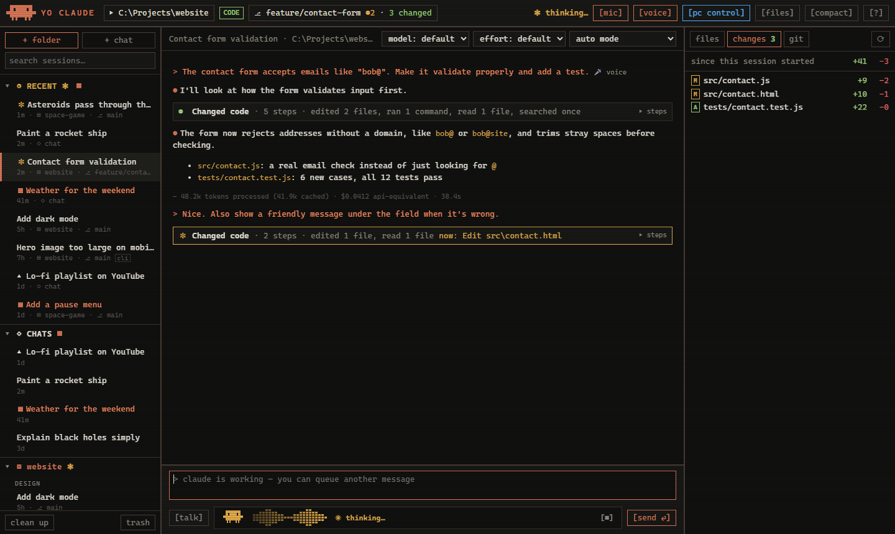
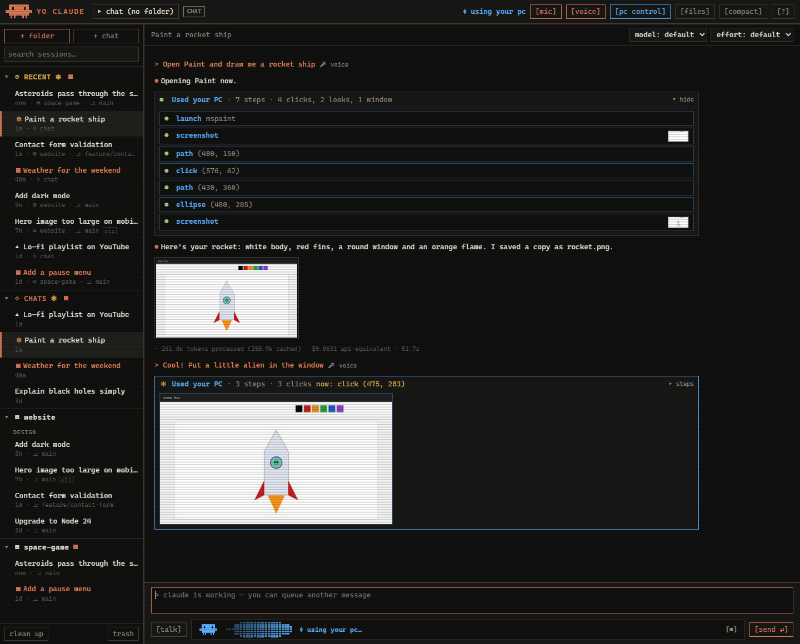
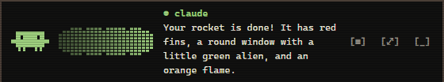
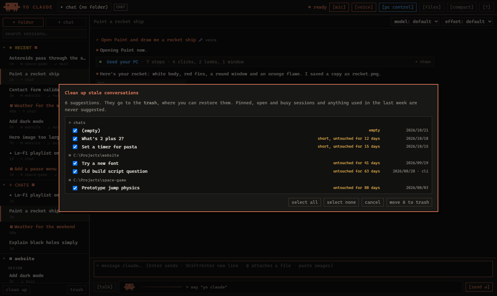
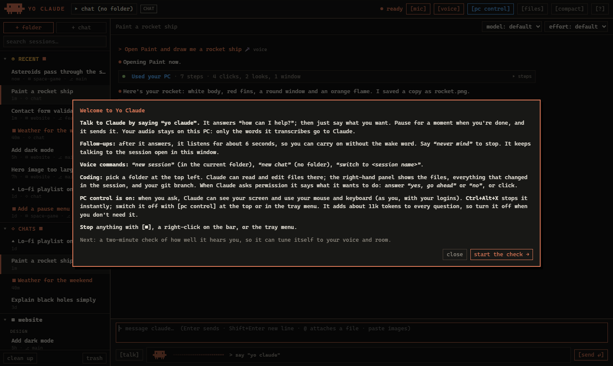

# Yo Claude

A "Hey Siri" for Claude on Windows. Say **"yo claude"**, ask anything out loud, and Claude answers in a natural
voice. Point it at a folder and it becomes a voice-first coding assistant: it reads and edits code, and shows its
work, every file it changed and your git branch. With PC control on, it can also use your screen, mouse and keyboard.

Unofficial fan project, not made or supported by Anthropic. Uses your own Claude account through Claude Code.



**Coding by voice or text.** Folders and their sessions on the left (spinning while Claude works, a dot for replies you
haven't read), Claude's steps folded into one-line summaries, and everything the session changed on the right.



**PC control.** "Open Paint and draw me a rocket ship": every click is grouped into one summary you can expand, with
what Claude saw, and a live view of the screen while it works.

| The compact bar | Cleaning up old conversations |
|---|---|
|  |  |



*(Screenshots use made-up content.)*

## What you need

- Windows 10 or 11, a microphone and speakers.
- A Claude **Pro or Max** subscription (Yo Claude uses it through Claude Code; it doesn't need an API key).
- Git, to download and update it: `winget install -e --id Git.Git` if you don't have it.

## Install

Open **PowerShell** and run:

```powershell
git clone https://github.com/SheldonNeilson/Yo-Claude.git "$env:LOCALAPPDATA\YoClaude"
& "$env:LOCALAPPDATA\YoClaude\Install Yo Claude.cmd"
```

The first command may ask you to sign in to GitHub (the repo is private: you need an invite). The installer then:

1. installs Python 3.13 if you don't have a suitable version (it asks first),
2. installs Yo Claude's packages, and PC control's in a separate environment,
3. downloads the speech models (about 550 MB; speech is recognised on your PC),
4. installs **Claude Code** if needed (asks first; Anthropic's official installer) and signs you in,
5. starts Yo Claude. It adds itself to the Desktop and Start menu and starts with Windows.

The first time, a welcome tour explains everything and checks how well it hears you (about two minutes).

## Using it

- **Say "yo claude"**, wait for "how can I help?", then speak. Pause briefly when you're done.
- **Follow-ups**: after it answers it listens for about 6 seconds, so you can carry on without the wake word.
  "Never mind" ends it.
- **Voice commands**: "new session", "new chat", "switch to *session name*".
- **Type** instead, in the window. `@` attaches a file, and you can paste screenshots. Click any attachment, picture,
  video or PDF in the conversation to view it; right-click for open, open with…, show in Explorer and copy path.
- **Folders and sessions**: `+ folder` adds a folder to the tree on the left; hover it and click `+` for a new session
  there. Sessions in different folders can work at the same time. **Recent** at the top lists the latest from every
  folder, and folders with recent activity open by themselves. Right-click a session to rename, pin, group, fork or
  delete it; **clean up** suggests old and empty conversations to move to the (restorable) trash.
- **Coding**: in a folder session, the right-hand panel shows the files, everything changed in the session (with
  diffs and per-file revert) and your git branch. When Claude asks permission, say "yes, go ahead" or "no", or click.
  The mode dropdown sets how much it asks: **auto** (Claude Code's safety check decides; the default), *ask before
  changes*, *auto-accept edits* or *plan*.
- **Model and effort** are picked per session (top of the conversation).
- **Compact mode**: close or minimise the window and a small bar stays at the bottom of the screen. `[⤢]` opens the
  window again.
- **Stop** anything: `[■]`, Esc, a right-click on the bar, or the tray menu.
- **Tray icon** (bottom right): the wake word, voice replies, PC control, the floating bar, launch with Windows,
  training mode, updates, and Quit.

## PC control

It's **on** after install. When you ask ("open YouTube and play lo-fi music"), Claude can see your screen and use
your mouse and keyboard, as you, with your logins.

- **Ctrl+Alt+X** stops it instantly. Slamming the mouse into a screen corner also aborts.
- Switch it off with `[pc control]` at the top of the window or in the tray menu.
- It asks before anything hard to undo (sending, deleting, buying), but don't leave it unattended on anything
  sensitive.
- It adds about 11k tokens to every question (screenshots add more), so turn it off when you don't need it.
- Everything it does is logged in `%USERPROFILE%\.yoclaude\pc-control\screen-control.log`.

## Privacy and cost

- Your **audio never leaves your PC**. The wake word and speech-to-text run locally; only the transcribed text goes
  to Claude.
- Replies are read aloud by Microsoft's online neural voice, so the reply text goes to Microsoft.
- Questions count against your Claude plan like Claude Code messages. A chat question is about 4k tokens; a coding
  session carries more (the full Claude Code toolset), mostly cached. Each reply in the window shows its token count.
  Listening for the wake word costs nothing.

## Updating

Tray menu → **Check for updates**. It also tells you when one is available.

## Uninstalling

Run `uninstall.ps1` in the install folder (right-click → Run with PowerShell), then delete the folder.
Your conversations stay in Claude Code.

## Troubleshooting

- **It doesn't hear me**: tray → *Training mode* checks your mic level and how it hears "yo claude", and can learn
  how you say it.
- **No answer**: run `claude` in a terminal once to check Claude Code works and you're signed in.
- **Something else**: tray → *Open log*, and send the log to whoever shared this with you.
